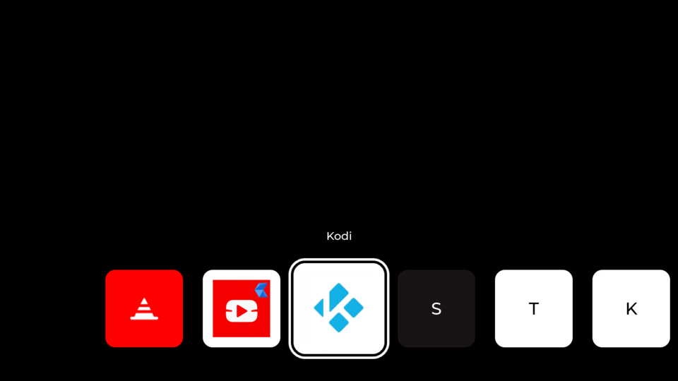

# webos-home-minimal

A minimal home screen for LG webOS TV (built for webOS 6): one row of app icons.

* **Left / Right** move the selection, **OK** launches the app.
* **Magic Remote pointer**: click a tile to launch it. The scroll wheel moves the selection.
* **Back** is ignored, because a home screen has nowhere to go back to.
* The app list is refreshed when you come back from another app.
* A config file can hide apps (blacklist).

Built with C++17, [LVGL 9](https://lvgl.io) and SDL2. LG ships SDL2 on webOS TV for native apps.
LVGL is fetched at configure time.



## Why LVGL + SDL2

LG's own SDL2 port is the only supported way for a native app to get a window on the webOS
compositor, so SDL2 is a given. LVGL sits on top and does the tiles, PNG decoding,
scaling, animation and hit-testing in about 1.3 MB. [moonlight-tv](https://github.com/mariotaku/moonlight-tv)
uses the same stack on webOS, so it is known to work there.

A leaner alternative is plain SDL2 + SDL2_image + SDL2_ttf with no GUI toolkit. For a UI this
small that is realistic, but you would write the layout, animation and click handling yourself.
LVGL keeps the UI code short (`src/launcher_ui.cpp`).

## How it talks to webOS

| What          | Luna call                                                                |
|---------------|--------------------------------------------------------------------------|
| List apps     | `luna://com.webos.service.applicationmanager/listLaunchPoints`, falling back to `listApps` |
| Launch an app | `luna://com.webos.service.applicationmanager/launch` `{"id": "...", "params": {...}}` |

`listLaunchPoints` returns what LG's launcher shows: visible apps and inputs in the user's
order, with `title`, `icon`/`largeIcon` (PNG paths) and `iconColor`. Calls go through the
`luna-send` binary (`src/luna.cpp`). If that fails, `luna-send-pub` is tried.

> **Permissions:** this needs a **rooted TV** (e.g. via [webosbrew](https://www.webosbrew.org/)
> / Homebrew Channel). Homebrew apps run jailed: there is no `luna-send`, and `luna-send-pub`
> is denied `listApps` / `listLaunchPoints`. When a direct call is denied, the launcher sends
> the same call to the Homebrew Channel's root service (`org.webosbrew.hbchannel.service/exec`),
> which runs `luna-send` as root. After the first success it goes there directly. Disable with
> `use_hbchannel = false`. If the list is empty, the screen shows why each call failed.

## Building

### Desktop (for development)

Needs the SDL2 development package (`libsdl2-dev`).

```sh
cmake -B build && cmake --build build -j
WEBOS_HOME_MOCK=mock/launchpoints.json WEBOS_HOME_WINDOW=1280x720 ./build/webos-home-minimal
```

`WEBOS_HOME_MOCK` reads the app list from a file instead of the Luna bus, and launches are
only logged. Esc quits (desktop builds only).

### webOS TV

1. Download the webOS toolchain `arm-webos-linux-gnueabi_sdk-buildroot` from
   [openlgtv/buildroot-nc4 releases](https://github.com/openlgtv/buildroot-nc4/releases).
   Its sysroot includes SDL2.
2. Install `ares-package` / `ares-install` (`npm install -g @webos-tools/cli`).
3. Build the package and install it:

```sh
scripts/package.sh ~/toolchains/arm-webos-linux-gnueabi_sdk-buildroot
ares-install build-webos/org.rrooij.homeminimal_0.1.0_arm.ipk
```

Change the app id with `-DAPP_ID=...` (and in the `.ipk` name above). A toolchain build sets
`-DWEBOS=ON` automatically. That makes the window fullscreen and enables LG's SDL hints.

## Configuration

The first file found is used:

1. path given as the first command line argument
2. `$WEBOS_HOME_CONFIG`
3. `$HOME/.config/webos-home-minimal/home.conf`
4. `home.conf` in the app's install directory (a commented example ships with the package)

```ini
# hide apps; shell-style wildcards, may be repeated
blacklist = com.webos.app.discovery
blacklist = com.webos.app.hdmi*
# alphabetical instead of launcher order
sort = title
# vertical position of the icons (center, top, or bottom; default: center)
# position = center
# force a specific luna client
luna_send = luna-send
```

The launcher always hides itself. To find app ids, run this on the TV:
`luna-send -n 1 -f luna://com.webos.service.applicationmanager/listApps '{}' | grep '"id"'`

## Background

The background is black. To use an image instead, put a JPEG named
`background.jpeg` in the app directory. The launcher opens it relative to its working
directory, which webOS sets to the app folder. It is scaled to cover the screen and cropped to fit. It is read at startup, so restart the app
after changing it. Reinstalling the IPK wipes that directory. To ship the image in the package,
put it at `webos/background.jpeg` before building.

## Making it *the* home screen

The app is a normal webOS app. It does not replace LG's launcher: the Home button still opens
LG's own home. On a rooted TV you can start it at boot with a Homebrew Channel init script,
e.g. `/var/lib/webosbrew/init.d/50-home-minimal`:

```sh
#!/bin/sh
sleep 10
luna-send -n 1 luna://com.webos.service.applicationmanager/launch '{"id":"com.example.homeminimal"}'
```

## Layout

```
src/main.cpp         event loop, remote key handling
src/sdl_backend.*    SDL2 window as LVGL display + pointer input
src/launcher_ui.*    the tile row (LVGL)
src/apps.*           listing, filtering and launching apps
src/luna.*           luna-send wrapper (fork/exec, no shell)
src/config.*         config file / blacklist
config/lv_conf.h     LVGL build config (PNG decoder, image cache, fonts)
webos/               appinfo.json, icon, default home.conf
mock/                sample listLaunchPoints reply for desktop testing
```


## Disclaimer

Mostly vibe-coded! But tested by me extensively on WebOS6.
